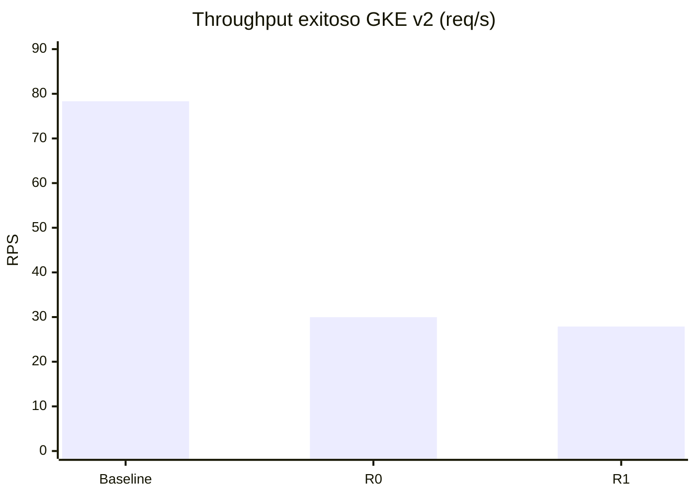
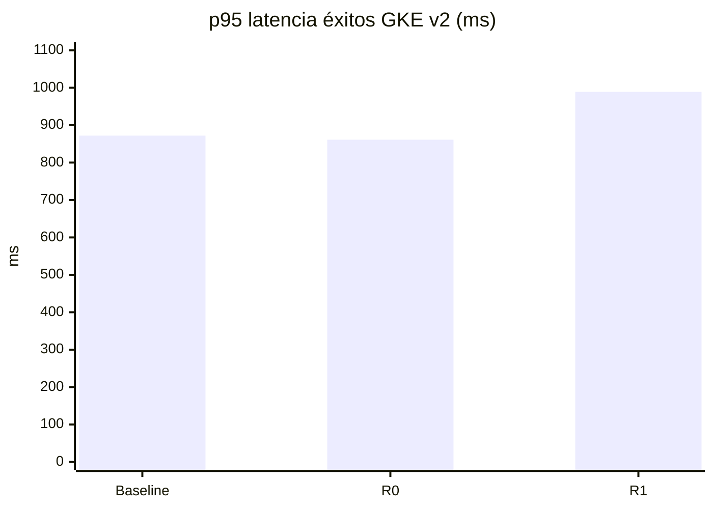
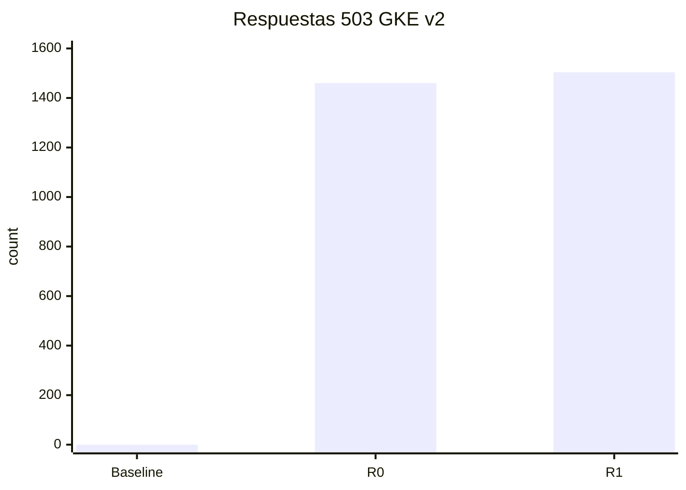

# Cierre — Experimento de saturación Cine (GCP / GKE)

**Rama:** `seguimiento-4-caos-daniel`  
**Serie oficial cloud:** GKE v2 (`*-k6-gke-v2.json`)  
**Evidencia histórica:** GKE v1 y local k6 v3 **intactas** (no sobrescritas)  
**Fecha de auditoría:** 2026-11-16

## 1. Hipótesis (sin reescritura retrospectiva)

> Bajo saturación de concurrencia comparable, R1 (bulkhead + admission) mejorará el **throughput exitoso** respecto a R0 y/o reducirá el impacto de errores no controlados (rechazos 503 + mejor p95 del tráfico admitido).

**Métrica primaria:** `successful_requests_per_second` (solo HTTP 2xx).

## 2. Metodología (GKE v2) — comparable

| Factor | Baseline | R0 | R1 |
|--------|----------|----|----|
| Réplicas | 1 | 1 | 1 |
| k6 arrival | 80/s × 30s | igual | igual |
| VUs | 40–120 | igual | igual |
| Saturación | off | holdMs=250, maxInflight=8, maxQueueWaitMs=200 | igual |
| Resiliencia | off | off | bulkhead→admission, timeout 200 ms |
| Endpoint | GET `/api/v2/peliculas/1` | igual | igual |
| Offered RPS | 78.37 | 78.67 | 78.03 |
| `offered_load_comparable` | — | — | **true** |

Techo físico del fallo ≈ `maxInflight/holdMs` ≈ **32 RPS**.  
Recuperación: `saturation/stop` + healthz/readyz/películas 200 tras cada ronda; cluster restaurado a **2 réplicas** + `EXPERIMENT_ROUND=baseline`.

**No se ejecuta una nueva ronda remota en este cierre:** la serie v2 es metodológicamente válida; el entorno GKE es compartido con la validación multicloud/OTEL de los compañeros. Protocolo de re-ejecución opcional: §8.

## 3. Resultados medidos (GKE v2)

| Métrica | Baseline | R0 | R1 | Δ R1−R0 |
|---------|----------|----|----|---------|
| Throughput exitoso (RPS) | 78.33 | 29.97 | 27.87 | **−2.10 (−7.0%)** |
| Tasa de éxito | 0.9996 | 0.3809 | 0.3571 | −0.0238 |
| Tasa de error (1−éxito) | 0.0004 | 0.6191 | 0.6429 | +0.0238 |
| Latencia p95 éxitos (ms) | 872 | 861 | 989 | +128 |
| Latencia p50 | No medida | No medida | No medida | — |
| Latencia p99 | No medida | No medida | No medida | — |
| HTTP 429 | 0 | 0 | 0 | 0 |
| HTTP 503 | 0 | 1460 | 1504 | +44 |
| Dropped iterations (k6) | 50 | 41 | 61 | +20 |
| Rechazos bulkhead (k6) | No medida* | No medida* | No medida* | — |
| Rechazos admission (k6) | No medida* | No medida* | No medida* | — |
| CPU / memoria | No medida | No medida | No medida | — |
| Tiempo recuperación (s) | No medida** | No medida** | No medida** | — |

\* Desglose por patrón (sondas ortogonales, **no** serie k6 ni multicloud 75 s):  
  - Bulkhead: `gke-v2-reject-probe.json` → **108× `bulkhead_timeout`** / 200 (R1+sat, BH=AD=8).  
  - Admission: `gke-admission-reject-probe.json` → **9× `inflight_limit`** / 80 (R1+sat, BH=8/AD=2); 66×200, 0×`bulkhead_timeout`, 5 client_error.  
\*\* Recuperación verificada funcionalmente (200 en healthz/readyz/películas tras stop); duración no cronometrada.







## 4. Interpretación R0 vs R1

**Causa de la diferencia (throughput):**

1. El fallo fija un techo ~32 RPS; ni bulkhead ni admission **aumentan** capacidad.
2. R1 añade cola corta (200 ms) + posible rechazo previo → overhead y ligeramente **menos** éxitos (−7 %).
3. p95 de éxitos **no mejoró** en GKE v2 (sí mejoró en serie local k6 v3: 452→254 ms).
4. Beneficio demostrable de R1: **rechazos controlados** con `x-reject-reason` (`bulkhead_timeout` y `inflight_limit` en sondas), no “errores opacos” ni hang indefinido del cupo.
5. Distinción: protección vía rechazo ≠ aumento de solicitudes exitosas.
6. La serie **multicloud 75 s** (Sports→Cine) midió disponibilidad/p95 bajo sat; **no** demuestra intervención de patrones (0×503). Ver `evidencias/MULTICLOUD_75S_SERIES.md`.

**Hipótesis de mejora de throughput R1>R0:** **NO confirmada** (GKE v2; coherente con GKE v1 y local k6 v3).  
**Hipótesis parcial de rechazo controlado:** **soportada** (sondas bulkhead + admission).  
**Mejora p95 en cloud (k6 Cine):** **no demostrada** en v2.  
**Eficacia de patrones vía multicloud 75 s:** **no atribuible** (sin rechazos).

## 5. Patrones — auditoría

| Patrón | Implementación | Evidencia |
|--------|----------------|-----------|
| Bulkhead | `bulkhead.ts` + timeout 200 ms | Unit tests + sonda GKE `gke-v2-reject-probe.json` (108× `bulkhead_timeout`) |
| Admission | `admission.ts`, cupo ≤ bulkhead | Unit tests + sonda GKE `gke-admission-reject-probe.json` (9× `inflight_limit`; AD=2, BH=8) |
| Orden R1 | bulkhead → admission → sat | Fix Continuación #7 (`f8fdc03`); con BH=AD=8 admission cede a bulkhead bajo sat pesada |
| R0 | solo saturación | Config `RESILIENCE_ENABLED=false` |

Defectos funcionales nuevos en esta auditoría: **ninguno**.  
No se retocan parámetros para fabricar mejora de RPS.

## 6. Evidencias (índice)

### A) Series de carga Cine (k6 directo)

| Archivo | Demuestra | No demuestra |
|---------|-----------|--------------|
| `evidencias/*-k6-gke-v2.json` | RPS/éxito/503/p95/oferta | Desglose por patrón |
| `evidencias/comparison-k6-gke-v2.json` | Δ R0→R1 | Confirmación de hipótesis de RPS |
| `evidencias/LAB_K6_GKE_V2_SUMMARY.md` | Metodología + restauración | Intervención admission |
| `evidencias/*-k6-gke.json` (v1) | Serie previa pre-fix | Post-fix |
| `evidencias/LAB_K6_V3_SUMMARY.md` | Serie local comparable | Cloud |

### B) Sondas de patrones (ortogonales a k6 y a multicloud)

| Archivo | Demuestra | No demuestra |
|---------|-----------|--------------|
| `evidencias/gke-v2-reject-probe.json` | Bulkhead en GKE (108× `bulkhead_timeout`) | Admission |
| `evidencias/gke-admission-reject-probe.json` | Admission en GKE (9× `inflight_limit`) | Throughput R1>R0 |
| `evidencias/admission-probe-preflight-state.json` | Estado pre-sonda | — |
| `evidencias/gke-admission-probe-recovery.json` | Restauración post-sonda | — |
| `evidencias/GKE_ADMISSION_PROBE_SUMMARY.md` | Resumen corto admission | — |

### C) Serie multicloud 75 s (Sports k6 → flujo → Cine)

| Archivo | Demuestra | No demuestra |
|---------|-----------|--------------|
| `evidencias/MULTICLOUD_75S_SERIES.md` | Baseline 264/264, R0/R1 186/186, p95, sat appliedCount, restore | Intervención bulkhead/admission |

## 7. Estado operativo al cierre

- GKE: ConfigMap `EXPERIMENT_ROUND=baseline`, `RESILIENCE_ENABLED=false`, BH=8/AD=8, **2/2 Ready**
- HTTP: healthz/readyz/películas **200**, Cloud SQL `up`
- OTLP: activo hacia collector OCI (ConfigMap + validación Samuel)
- Multicloud: no alterada por el cierre documental
- Sondas de patrones y serie 75 s **ya ejecutadas**; no se relanza caos en Continuación #21
## 8. Protocolo opcional de re-ejecución (no lanzado)

Solo si el grupo coordina ventana sin pruebas E2E compartidas:

```powershell
# Misma carga/sat; escribe *-k6-gke-v3.json vía CINE_GKE_SERIES=v3
$env:CINE_GKE_SERIES = 'v3'
$env:CINE_PUBLIC_URL = 'http://35.239.107.54'
.\scripts\chaos\run-k6-gke-series.ps1
```

Requisitos: 2 réplicas Ready → script escala a 1 → baseline/R0/R1 → restore 2 + baseline.  
No crear infra nueva. No tocar Sports/Hotel.

## 9. Qué falta para cerrar la parte Cine (rúbrica)

- [x] Experimento reproducible documentado
- [x] Baseline / R0 / R1 con carga comparable (k6 GKE v2)
- [x] Serie multicloud 75 s documentada (sin atribuir eficacia de patrones)
- [x] Evidencia de patrones: bulkhead + admission (sondas GKE)
- [x] Recuperación y 2 réplicas
- [x] Conclusión honesta de hipótesis throughput
- [x] OTEL + W3C (Samuel/Jarrison)
- [ ] Publicación rama/tag en GitHub (**autorización**; comandos preparados)
- [ ] Informe académico final del grupo (integración de las 3 nubes)
- [ ] Limpieza GCP post-sustentación (**autorización explícita**; ver `LIMPIEZA_POST_SUSTENTACION.md`)
