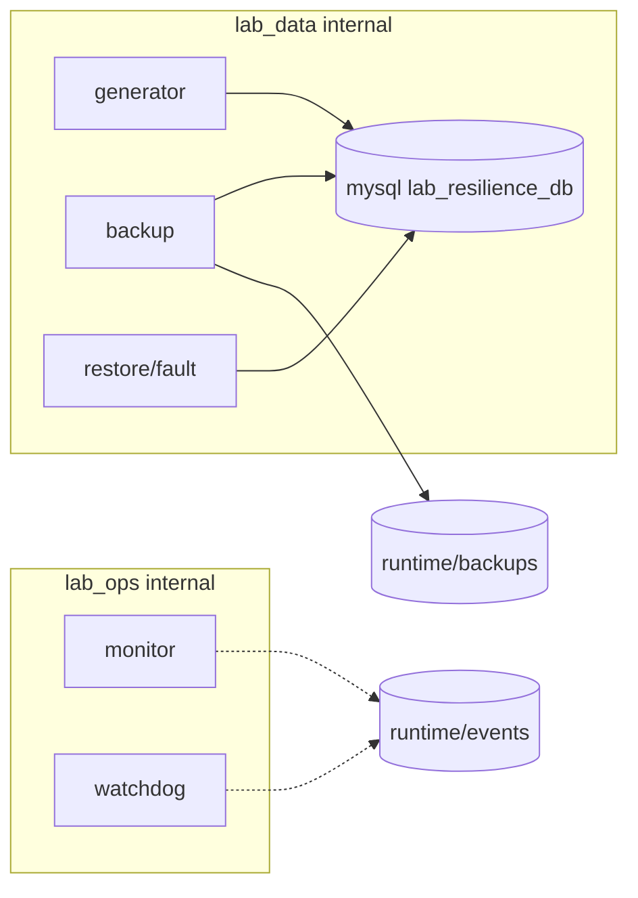

# Experimento 4 — Resiliencia y recuperación de datos (RPO / RTO)

Laboratorio Docker Compose **aislado** del proyecto grupal de Defensa en Profundidad.

| Campo | Valor |
|---|---|
| Paquete | `entrega-grupal/experimento-4-resiliencia-datos/` |
| Proyecto Compose | `seguridad-caos-exp4` |
| Base sintética | `lab_resilience_db` |
| Rama de trabajo tipica | `feat/defensa-profundidad-oci` |
| Release DevOps protegida | `v1.2.0` (**no modificada**) |
| Estado 2026-11-18 | **OCI medido. Smoke ARM64, R0 manual y R1 (G1+G2) PASS. VM sigue RUNNING.** |

> Este laboratorio **no** usa Hotel OKE, Hotel MySQL, Sports AWS, Cine GCP ni observabilidad compartida.

## Objetivo

Medir, con evidencias UTC:

- **RPO observado** (commits confirmados perdidos + antigüedad del backup restaurado)
- **RTO observado** (`t_servicio_ok - t_fallo`)
- Integridad post-restore

comparando **R0** (backup infrecuente + restore manual guiado) vs **R1** con exactamente dos mejoras:

- **G1** — backup adicional en el mismo plan de escrituras (R0/R1 equivalentes)
- **G2** — restore automatizado + integridad; R0 espera intervención manual real

## Arquitectura (resumen)



Detalle: [`docs/01-arquitectura.md`](docs/01-arquitectura.md).

## Estructura

- `lab/mysql` — schema sintético
- `lab/generator` — commits identificables
- `lab/backup` — mysqldump + SHA256 + retención
- `lab/restore` — restore seguro + `fault.py` (seguro por defecto)
- `lab/monitor` / `lab/watchdog` — detección y TTL
- `scripts/` — preflight, runners, stop, métricas
- `docs/` — RoE, hipótesis, R0/R1, RPO/RTO, OCI futuro
- `evidencias-publicas/` — vacío hasta corridas autorizadas
- `runtime/` — local, gitignored

## Seguridad operacional

- Sin `ports:` al host.
- Redes `internal: true`.
- Destino de restore con allowlist + `lab_meta.project`.
- Fallo lógico (no wipe de datadir).
- Runners requieren `-Authorized` / `--authorized` y `EXP4_ALLOW_COMPOSE=1`.
- Watchdog sin docker.sock / sin privilegios / sin egress.
- Modelo OCI Linux: **runners Bash** (`scripts/*.sh`); Windows local: `*.ps1`.
- Evidencias Git: `git-lab-status.ps1` / `git-lab-status.sh` (usa `git -C`, nunca `Push-Location ../../..`).

## Cómo validar (permitido sin R0/R1/OCI)

```powershell
cd entrega-grupal/experimento-4-resiliencia-datos
docker compose -p seguridad-caos-exp4 -f docker-compose.yml config
py -3 -m pytest tests -q
.\scripts\preflight.ps1
.\scripts\git-lab-status.ps1
.\scripts\run-r0.ps1          # debe rechazar sin -Authorized
```

Linux / VM OCI (futuro):

```bash
./scripts/preflight.sh --check-docker-config
./scripts/prepare-linux-perms.sh
./scripts/git-lab-status.sh
```

## Cómo se ejecutaron R0/R1 en la VM

```powershell
$env:EXP4_ALLOW_COMPOSE="1"
.\scripts\init-runtime.ps1
.\scripts\run-r0.ps1 -Authorized -MaxMinutes 30
.\scripts\run-r1.ps1 -Authorized -MaxMinutes 30
.\scripts\stop-experiment.ps1 -Reason operator_stop
```

```bash
export EXP4_ALLOW_COMPOSE=1
./scripts/init-runtime.sh
./scripts/run-r0.sh --authorized --max-minutes 30
# operador: ./scripts/restore-manual-r0.sh --run-id ... --backup-id ... --authorized
./scripts/run-r1.sh --authorized --max-minutes 30
./scripts/stop-experiment.sh --reason operator_stop
```

## Ejecución OCI del 2026-11-18

El primer intento de SSH no llegó a `opc`: el Bastion aceptaba la clave de recuperación y el reenvío a `10.31.1.229:22` se cerraba sin banner. Eso quedó registrado y no es el resultado del experimento. Después de permitir el egreso TCP/22 desde el endpoint del Bastion hacia la VM, la sesión llegó a OpenSSH 9.9. No había canal independiente para la host key (la consola serie exigiría reiniciar la VM). Se fijó, por TOFU controlado, solo la clave ED25519 `SHA256:xbBQD+74VVxYKTl80F4ExSXi/39MMaD5mQihfEtjY4s` en un `known_hosts` exclusivo, y las conexiones siguientes usaron `StrictHostKeyChecking=yes`.

Sobre Oracle Linux 9.8 `aarch64` se instaló Docker Engine 29.10.0 y Compose v5.8.0. El smoke, R0 y R1 corrieron solo en `lab_resilience_db`.

| Métrica | R0 | R1 |
|---|---|---|
| RPO observado | 3,629 s | 2,209 s |
| RTO observado | 13,056 s | 1,792 s |
| MTTD | 0,300 s | 0,109 s |
| Commits perdidos | 6 | 3 |
| Commits recuperados | 10 | 13 |
| Integridad | PASS | PASS |
| Servicio recuperado | PASS | PASS |

Detalle para el informe: [`docs/RESUMEN-PARA-JARRISON.md`](docs/RESUMEN-PARA-JARRISON.md). Evidencias: [`evidencias-publicas/`](evidencias-publicas/).

## Documentación

| Doc | Contenido |
|---|---|
| [01-arquitectura](docs/01-arquitectura.md) | Componentes y aislamiento |
| [02-estado-estable](docs/02-estado-estable.md) | Precondiciones |
| [03-hipotesis](docs/03-hipotesis.md) | Hipótesis falsable |
| [04-reglas-compromiso](docs/04-reglas-compromiso.md) | RoE |
| [05-r0-r1-g1-g2](docs/05-r0-r1-g1-g2.md) | Diseño experimental |
| [06-metricas-rpo-rto](docs/06-metricas-rpo-rto.md) | Fórmulas |
| [07-parada-rollback](docs/07-parada-rollback.md) | STOP/TTL (≠ destroy VM) |
| [08-plan-oci-vm](docs/08-plan-oci-vm.md) | Despliegue futuro |
| [09-riesgos](docs/09-riesgos-residuales.md) | Riesgos residuales |
| [10-sustentacion](docs/10-guia-sustentacion.md) | Guía oral |
| [11-portabilidad](docs/11-portabilidad-linux-arm64.md) | Bash/Linux + ARM64 |
| [12-cleanup-oci](docs/12-cleanup-oci.md) | Limpieza por OCID (post-sustentación) |
| [13-costos](docs/13-costos-oci-exp4.md) | Costos 9 h / 12 h |
| [17-ventana-oci](docs/17-ventana-oci-vs-ttl-sustentacion.md) | Vida OCI ≥9 h vs TTL |
| [18-prep-despliegue](docs/18-prep-despliegue-oci.md) | Prep apply (bloqueadores acceso) |
| [RESUMEN-PARA-JARRISON](docs/RESUMEN-PARA-JARRISON.md) | Resultado real para el informe grupal |
| [MENSAJE-PARA-JARRISON](docs/MENSAJE-PARA-JARRISON.md) | Mensaje breve de entrega |
| [oci/](oci/README.md) | Diseño Terraform (disabled) |

## Integridad DevOps

No modifica `seguridad-caos-exp2/`, Terraform, K8s, pipelines ni `v1.2.0`.
